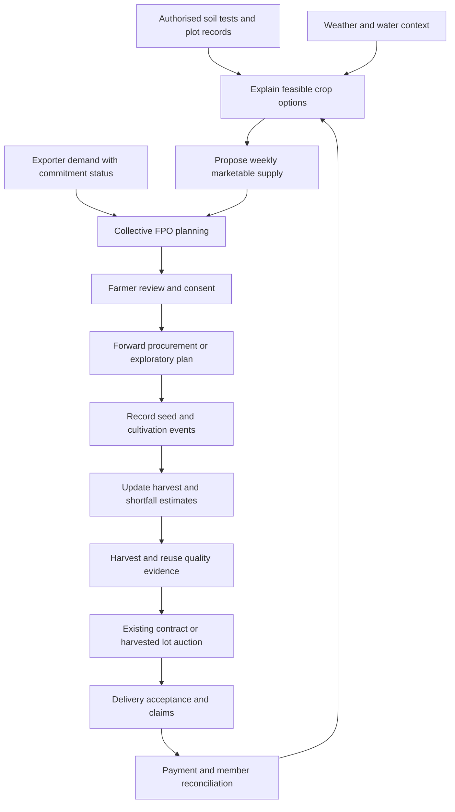

# Meraki

Meraki helps FPOs propose feasible crops, coordinate farmer-approved production against buyer requirements, and manage procurement through delivery and farmer settlement.

**Current status:** the crop-planning application remains a React/Vite browser prototype. Part 3 adds a separate API-backed trade development workspace for auctions through settlement, with explicit synthetic identities and production gates. Parts 1 and 2 integrations and field/commercial validation are not complete. Original frontend baseline: `dddaa7cc4aab040802e8795b03565ad1d14d48c0`.

- [Demo](https://meraki-tau-opal.vercel.app/) — deployed content may differ from this checkout.
- [Full Final 3.0 execution plan](docs/EXECUTION_PLAN.md)
- [Implementation status and acceptance backlog](Agent.md)
- [Agent working instructions](AGENTS.md)
- [Validation and resume checkpoint](docs/WORK_LOG.md)
- [Part 3 setup and operating guide](docs/PART3_OPERATIONS.md)
- [Part 3 API contract](server/CONTRACT.md)

## Product journey



Rank crop options using soil, season, water, resources, expected net returns and credible market access. Highest gross yield alone is not the objective. Farmers can accept, modify or decline proposals.

## Run the current prototype

Use a maintained Node.js release compatible with the lockfile. Existing CI uses Node 20; the documentation baseline was also checked locally with Node 24.22.1 and npm 11.19.1. No runtime upgrade is included in this change.

```sh
npm ci
npm run dev
```

Open the URL Vite prints. For a production bundle and local preview:

```sh
npm test
npm run build
npm run preview
```

`npm test` runs Vitest; `npm run build` runs TypeScript project checks and Vite. There is no configured lint or browser-test command. `npm ci` requires registry access. No API keys or backend are needed for the current synthetic demo.

For the trade workspace, first create a Python 3.12+ `.venv` and install `server/requirements.txt`, then run **`npm run dev:trade`**. It starts Vite, the localhost API and the unattended auction worker. Open `/trade` and choose a clearly labelled development identity. See [setup commands and gates](docs/PART3_OPERATIONS.md). Trade actions never fall back to browser-local success if the API is unavailable.

Planning data persists in this browser's local storage with an in-memory fallback. It is not a shared database, an authentication boundary or a safe multi-user reservation ledger. Trade records persist separately in the API database. The demo reset clears planning records in that browser; it does not reset trade records. The planner uses a fixed synthetic scenario date of **16 November 2026**, not live time.

## Implemented versus unfinished

| Capability | Verified evidence | Status and limit |
|---|---|---|
| FPO navigation and forms | `src/routes/AppRoutes.tsx`, `src/pages/` | Implemented prototype; not an exporter portal |
| Buyer requirements and specification history | `BuyerOrdersContext.tsx`, order pages | Browser-local demo records; no verified buyer commitments |
| Farmers, plots, crop cycles and participation | `FarmersService.ts`, types and forms | Prototype CRUD and consent records |
| Collective planting suggestions | `src/planning/engine.ts` | Explainable rules with synthetic crop assumptions; not trained yield AI |
| Farmer response/replanning flow | `PlanContext.tsx`, `Messages.tsx` | Simulated messages/replies; no delivery provider |
| Weekly charts | `src/planning/series.ts` | Uniform distribution over windows; not observed picking curves |
| Existing-crop supply plans | `SupplyPlanningService.ts`, supply pages | Preview, adjustments, confirmation/cancellation and local reservations; no cross-client atomicity |
| Soil record fields | `src/types/index.ts`, plot forms | Basic report/pH/moisture representation; no full SHC analyte/provenance pipeline |
| Planning and trade regression tests | `src/planning/engine.test.ts`, `src/trade/*.test.ts`, `server/tests/`, `tests/part3_acceptance/` | 25 frontend and 69 SQLite API/acceptance tests pass locally; PostgreSQL results are recorded separately in the work log |
| Lots, lab review, shipments, claims, settlements | `src/trade/`, `server/`; legacy URLs redirect to trade routes | API-backed development workflows; partner/production gates remain |
| Trade API, persistence and close/expiry worker | `server/`, `scripts/dev-trade.mjs` | Isolated Part 3 implementation; not the complete Part 2 identity/market backend |
| Spot and forward procurement | `src/trade/`, `server/CONTRACT.md` | Whole-lot/request modes; live identity/capacity integration remains gated |
| Government APIs, OCR and validated ML | No implementation in inspected tree | Planned; access/data gates apply |

Source inspection establishes implementation presence, not operational or agronomic validation. See [the ledger](Agent.md) for task-level evidence and acceptance criteria.

## Current and target stack

**Installed today:** React 18, TypeScript 5.6, Vite 5, React Router 6, Tailwind 3, Lucide icons and Vitest 2. Exact resolutions live in `package-lock.json`; do not describe recommended packages as installed.

**Part 3 stack:** React trade screens plus FastAPI/Pydantic/SQLAlchemy, PostgreSQL target and file-backed SQLite for local development, and a separate close/expiry worker. Trade writes are transaction-protected; development identities are explicit and production operation fails closed until Part 2 adapters exist. See `server/requirements.txt` for exact Python pins.

**Remaining target infrastructure:** shared Part 2 identity/capacity, PostGIS where required, private object storage, broader ingestion/notification jobs and production deployment. Celery/Redis remains a candidate, not installed infrastructure. A local trade module does not complete those shared services.

Python rules/scenarios come first. Later candidates include scikit-learn for properly labelled prediction and OR-Tools for constrained allocation. OCR, mapping, improved API state/forms, telemetry and managed auth/storage providers should be introduced only for an accepted task with pinned dependencies and measured need.

## Data and agronomic contract

- Actual SHC results require authorised access or member-authorised lab/card imports. Published API documentation does not mean access is approved. FPO staff can verify imports without farmers typing chemistry values.
- Preserve plot/sample linkage, raw units, analyte basis, method, depth, dates and source. Mapped total nitrogen is not SHC available nitrogen. Missing data stays unknown.
- Weather forecasts retain issue time and horizon. Historical NASA POWER weather is not future weather. Regional groundwater observations do not establish an individual farm's pumping capacity or reliable supply.
- Actual seed lot, fertiliser, pesticide and irrigation events require consented operational records. Purchase and planned application are not verified application.
- Pre-sowing decisions use only data available at that time. Do not train on future rainfall, later crop imagery or final harvest information and claim pre-sowing performance.
- No suitable linked local soil–management–vegetable-yield dataset has been established for this product. The earlier small crop-classification experiment is not a validated farm-yield model. Collect real outcomes and beat independent baselines before model deployment.
- Crop/input guidance needs qualified local review. Photos, self-reported spray logs and sensors do not certify pesticide safety or export compliance.

Weekly scenarios separate gross harvest, grade share, FPO commitment and retention:

```text
weekly allocatable kg =
  area_ha × gross_yield_t_per_ha × 1000 × weekly_harvest_share
  × eligible_grade_fraction × FPO_committed_fraction × retention
  constrained by logistics, timing, holds and existing reservations
```

Do not apply grade loss twice to an already-marketable yield. Compare crop/variety/grade/location/week obligations; aggregate seasonal tonnes do not prove coverage. Without an actual buyer, show feasible capacity and exploratory scenarios, not instructions to sow for an assumed sale.

## Market and auction rules

1. **Harvested lots:** eligible exporters bid upward for available produce; highest eligible price wins if the disclosed reserve is met.
2. **Forward procurement:** qualified FPOs quote future supply; lowest comparable eligible price wins, or use a scoring rule disclosed before bidding.
3. Server time, deterministic rules and atomic capacity reservations govern awards. First arrival breaks equal bids only. Browser timers/local storage cannot decide live winners.
4. Proposed versus accepted planting, growing forecasts, inspected stock and signed obligations remain distinct. Duplicate enquiries and capacity already committed elsewhere must not inflate available supply or demand.
5. Auction schedule, extensions, partial awards, fees, confirmation/default rules and quality acceptance must be agreed before live operation. The full plan contains proposed defaults, not live contracts.

## Execution sequence

| Phase | Deliverable | Exit condition |
|---|---|---|
| P0 | Scope, evidence ledger, source/permission register | Real versus hypothetical inputs explicit; crop and partner access documented |
| P1 | Typed soil/environment records and imports | Correct plot, units, timestamps, review and missing-data behaviour |
| P2 | Reviewed crop alternatives and weekly marketable plan | Water/resources/consent enforced; no-orders and common-shock scenarios work |
| P3 | Authenticated backend and durable capacity ledger | Organisation isolation, atomic reservations and migration/restore checks |
| P4 | Exporter workspace and market discovery | Dated eligible matching, demand states and duplicate review |
| P5 | Both auction modes and contract workflow | Concurrent bids, deadlines, retries/defaults and no overselling verified |
| P6 | Cultivation-to-acceptance and settlement | One complete reconciled journey with claim and failure paths |
| P7 | Supervised pilot and model evaluation | Paid repeat usefulness, full variable costs and independent outcomes measured |

Phases can deliver UI prototypes before backend work, but multi-user transactions require P3. A crop-cycle pilot cannot be completed by a short software sprint. Detailed dependencies, tests and stop/resume instructions are in [Agent.md](Agent.md).

## Business and impact

Test buyer-funded planning subscriptions, disclosed fees on accepted volume and separately priced coordination. These are hypotheses; no prices, margins, yield improvements or farmer-income gains are established by this repository. Measure cost per accepted kg, accepted-on-time quantity, weekly forecast error, coordinator time, farmer net receipts and payment delay against current practice.

## Working on the project

Read [AGENTS.md](AGENTS.md), then select one ready acceptance task from [Agent.md](Agent.md). Record actual checks and checkpoint in [docs/WORK_LOG.md](docs/WORK_LOG.md). Passing frontend tests does not complete backend, field or commercial milestones. Instructions and checkpoints support resumption; they do not automatically run an agent after it is paused.

The repository currently has no `LICENSE` file. Do not infer permission to reuse third-party code, data or model weights from public visibility; record applicable terms for each addition.

## Live crate sensor checkpoint

Run `npm run dev:sensors` for the separate live sensor tab and ESP upload gateway. See [LAN setup, API contract and ESP example](docs/LIVE_SENSORS.md). This is an optional final handling checkpoint after the exporter/FPO workflow; hardware connectivity and hosted deployment remain unverified.
