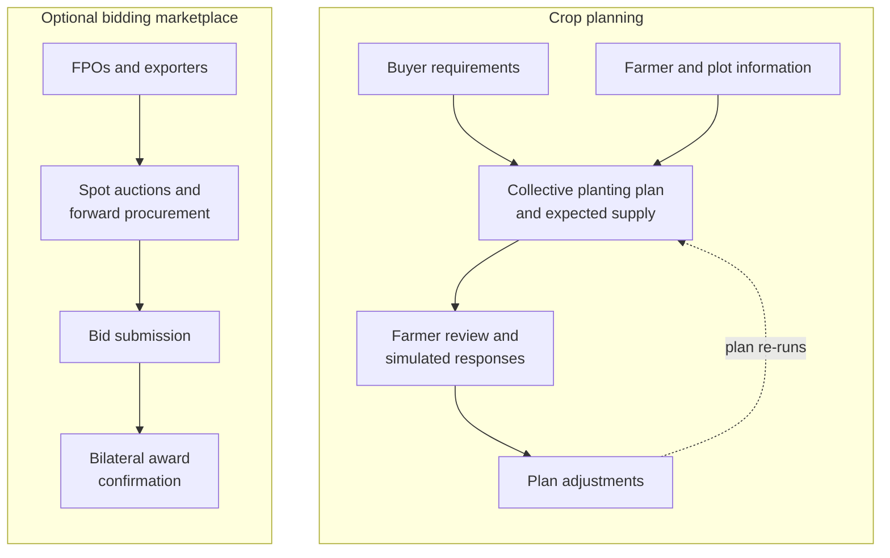

# Meraki

Demand-driven crop planning for Farmer Producer Organisations (FPOs).

Meraki helps an FPO decide what its members should grow, and how much, based on what buyers actually want. It turns buyer requirements into a collective planting plan, gives a simple yield outlook for candidate crops, and helps coordinate farmers around the plan. An optional bidding marketplace gives FPOs and exporters an additional way to trade produce.

**Singapore–India Hackathon 2026 · Sustainability Track · Team Meraki (SUS-3)**

## Live demo

**[meraki-tau-opal.vercel.app](https://meraki-tau-opal.vercel.app/)**

To explore without an account, choose **FPO planning demo** on the entry screen. It opens the season overview, which links each step of the planning journey (buyer demand, planting plan, farmer messages, replies). **Exporter demo** opens the exporter workspace instead. To place bids that other users can see, sign in or create a demo account. All farms, farmers, orders and bids in the demo are synthetic. The demo runs on free-tier hosting, so it may take a moment to wake up and will not stay online indefinitely.

## Problem

Smallholder farmers often choose crops individually, guided by last season's prices. When many farmers make the same choice, local markets flood and prices fall; other crops go short. FPOs are well placed to coordinate production, but they rarely have simple tools to match their members' land and capacity to buyer demand before sowing. Buyers and exporters, in turn, struggle to secure consistent volumes, varieties and delivery timing.

## What we built

- **Collective crop planning.** A rule-based planning engine plans each buyer order separately by variety, quantity and delivery window. It works back the latest sowing date and assigns land from participating farmers' plots based on timing, water and soil. Every recommendation shows its reasons. Managers can compare cautious and more ambitious scenarios and see the supply gap for each order.
- **Crop yield outlook.** A quick comparison of seven crops for a given plot area, using fixed reference yields per hectare scaled by area. It is a planning aid, not a prediction and not a judgement of whether a particular plot suits a crop.
- **Farmer coordination.** Farmer and plot records, participation consent, and planting instructions drafted for WhatsApp or SMS in English, Hindi, Marathi, Tamil or Malayalam. Farmer replies (confirm, decline, or report a problem) feed back into the plan, which rebalances and records what changed. Messages are simulated in the prototype; unsupported farmer language preferences remain visible and require coordinator confirmation for the selected draft language.
- **Buyer demand.** Committed orders, indicative interest and market signals are kept separate, so a forecast is never treated as a confirmed order.
- **Optional bidding marketplace.** FPOs and exporters sign in to a shared auction board backed by a server and database. Exporters bid on harvested produce and FPOs quote for forward requirements. Deadlines close automatically, and both sides must confirm an award.

## Product workflow

The prototype has two separate workflows. Crop planning is the core; the bidding marketplace is optional. They do not share data automatically.



## Proposed business model and intended impact

The proposed commercial model has three parts. None of it is implemented in the prototype, which has no subscription billing or fees.

- **FPO subscription:** access to crop planning and farmer coordination tools.
- **Exporter subscription:** access to supplier discovery and procurement opportunities. It may be priced lower than the FPO subscription because its current feature scope is narrower.
- **Marketplace success fee:** transaction-based revenue from completed marketplace sales.

Meraki's intended impact is higher net income for farmers: planting what buyers need reduces gluts, distress sales and wasted produce. This has not been measured.

## Prototype status and limitations

Meraki is a hackathon prototype. It is not a production-ready agricultural platform.

- **Data:** all demo data is synthetic. Crop timings, yields and suitability rules are indicative assumptions that a qualified agronomist has not reviewed.
- **Yield figures:** the yield outlook uses fixed reference values. An earlier yield model trained on synthetic data remains in the repository as an experiment ([details](docs/SYNTHETIC_YIELD_POC.md)), but the app does not use it. No model has been trained or validated on real farm outcomes.
- **Planning storage:** planning data lives in the browser's local storage. It is not a shared, multi-user system.
- **Messaging:** WhatsApp/SMS messages and farmer replies are simulated.
- **Marketplace:** it uses demo accounts and synthetic stock, and moves no money. Trading of real harvested lots is disabled.
- **Other modules:** the repository also contains separate development workflows for lots, lab review, shipments, claims and settlements. They are not an integrated procurement tracking system.
- **Additional experimental modules:** a crate temperature sensor page (reachable from the FPO navigation), plus a public weather and market data gateway and a farm-data workspace whose pages are not currently routed. Their source code remains in the repository.
- **Licence:** the repository has no licence file. Please contact the team before reusing code or data.

## Technology stack

- **Frontend:** React 18, TypeScript, Vite, React Router, Tailwind CSS, Lucide icons; tested with Vitest.
- **Backend:** Python 3.12, FastAPI, Pydantic, SQLAlchemy and Alembic. PostgreSQL for the marketplace, SQLite for local development, and a background worker for auction deadlines.
- **Hosting:** Vercel (frontend) and Render (API and PostgreSQL).

## Local setup

The crop-planning demo runs in the browser with no backend:

```sh
npm ci
npm run dev
```

Open the URL that Vite prints. Without the backend, the sign-in form cannot connect, but the demo still works: choose **FPO planning demo**, then follow the progress steps on the overview.

To run the frontend checks:

```sh
npm test
npm run build
```

The bidding marketplace needs the Python API, PostgreSQL and the deadline worker. Docker Compose starts all three; see [auction setup](docs/AUCTION_BACKEND.md). The Python test suites and data reproducibility checks are listed in the [documentation index](docs/README.md#running-the-checks).

## Technical documentation

The [documentation index](docs/README.md) groups the remaining material into three sections:
- **Prototype setup and technical architecture:** hosting, the marketplace backend and the API contract.
- **Agricultural data and model research:** the public data foundation, model validation and the synthetic yield experiment.
- **Development history:** the original execution plan, audits, the implementation ledger, the work log and the tasks left open at the end of the hackathon.
